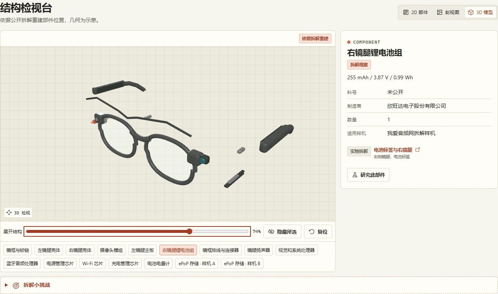
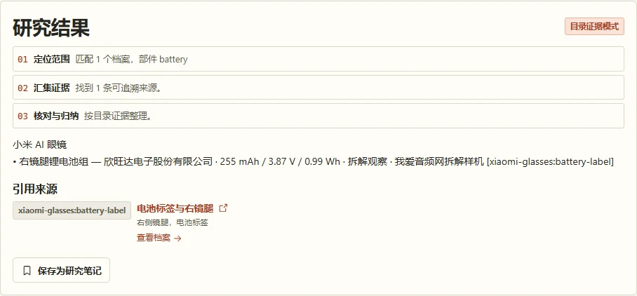

# Hardware Field Atlas · 硬件志

**从一个零件料号，追到整机、拆解、3D 结构和原始证据。**

[下载最新版](https://github.com/topbat/hardware-field-atlas/releases/latest) · [三分钟启动](#三分钟启动) · [看看界面](#界面实拍) · [版本记录](CHANGELOG.md) · [English summary](#english-summary)

[](https://github.com/topbat/hardware-field-atlas/actions/workflows/delivery.yml) [](https://github.com/topbat/hardware-field-atlas/releases/latest) [](LICENSE)


想知道 AI 眼镜怎么塞进摄像头和电池、语音终端断网后还能做什么，或者两款设备到底差在哪？硬件志把散落在商品页、厂商资料、开源项目和拆解记录里的信息整理成可以搜索、比较、旋转和追溯的中文研究档案。首版收录 **17 款**以国内产品和开源方案为主的样本，横跨玩具、眼镜、音箱、镜子、柜子和电脑桌。

## 可以怎么玩

| 你想做什么 | 从哪里开始 |
| --- | --- |
| 从零件找到整机 | 搜 `ESP32-S3` 或 `BES2700H`，从料号结果进入部件详情，顺着引用看原始资料 |
| 像拆机一样看产品 | 打开小米 AI 眼镜、小智 ESP32 参考硬件或小米智能音箱 Pro 的「结构检视」，旋转、展开模型，点选部件并查看对应 BOM |
| 快速看懂一个陌生品类 | 打开「AI 图解」，逐张查看 66 张部位图、51 张独立角度图及各产品的规格图。实物图、重绘示意与已核验规格分开展示 |
| 比较多个方案 | 把产品加入对比，查看硬件规格、AI 能力、计算位置和离线行为，并追溯字段出处 |
| 把资料整理成一个问题 | 在研究室选定范围，使用证据问答或复现工作流；已有笔记经主动选择后可作为上下文。目录模式开箱即用 |
| 补充一条新证据 | 在档案提交纠错，管理员在审核页处理并保存修订记录 |

## 三分钟启动

有 Docker 时，直接下载已经构建好的镜像，无需配置模型密钥。镜像以 **Linux x86-64（amd64）** 为发布目标，Docker Desktop 用户使用 Linux 容器模式。

```sh
docker pull ghcr.io/topbat/hardware-field-atlas:v0.1.0
docker run -d --name hardware-field-atlas --init \
  --read-only --tmpfs /tmp --cap-drop ALL --security-opt no-new-privileges:true \
  -p 127.0.0.1:8765:8765 -v hardware-atlas-data:/var/lib/atlas \
  ghcr.io/topbat/hardware-field-atlas:v0.1.0
```

Windows PowerShell 可将 `docker run` 命令写在一行。启动后访问 [目录](http://127.0.0.1:8765/)、[小米眼镜的部位与角度图](http://127.0.0.1:8765/products/xiaomi-glasses?view=illustration) 或 [API 文档](http://127.0.0.1:8765/api/docs)。

如果需要离线分发，从 [Release](https://github.com/topbat/hardware-field-atlas/releases/latest) 下载 `hardware-field-atlas-v0.1.0-linux-amd64.tar.gz` 、`image-digest.txt` 和 `SHA256SUMS`，先执行 `sha256sum -c SHA256SUMS`（Windows 用 `Get-FileHash -Algorithm SHA256` 对照），再执行 `docker load -i hardware-field-atlas-v0.1.0-linux-amd64.tar.gz`，运行同一条 `docker run` 命令。

## 界面实拍

以下截图来自运行中的站点。截图使用站内概念图和重建资产，实物图库仍保留原始来源入口。

| 一张图只讲一个关键部位 | 部件与模型联动 |
| --- | --- |
|  |  |



## 从源码运行

| 用途 | 环境 |
| --- | --- |
| 后端与测试 | Python 3.12、uv（发布使用 0.12.17） |
| 前端 | Node.js 22.12+，推荐 Node.js 24，以及随 Node 安装的 npm |
| 容器部署 | Docker Engine 或 Docker Desktop，使用 Compose 时需 Compose 2.24+ |
| 资产重建（可选） | Blender 5.2、ImageMagick 7。浏览和运行站点使用仓库中已打包的资产 |
| AI 文本与图像研究（可选） | 兼容 Chat Completions 的模型接口和相应权限 |

```sh
git clone https://github.com/topbat/hardware-field-atlas.git
cd hardware-field-atlas
uv sync --locked --python 3.12
npm --prefix web ci
npm --prefix web run build
uv run --no-sync uvicorn atlas.main:create_app --factory --app-dir server --host 127.0.0.1 --port 8765 --no-proxy-headers
```

Windows 可运行 `pwsh -File scripts/start.ps1 -Build`，之后省略 `-Build` 可复用前端构建，`-Port` 可改端口。前端联调时让后端留在 `8765`，另开终端运行 `npm --prefix web run dev`，访问 [Vite 开发页](http://127.0.0.1:5173/)。

也可以从源码运行 `docker compose up -d --build`，使用 `docker compose logs -f atlas` 查看日志。Compose 默认只监听本机回环地址，并把运行数据保存在命名卷。用于对外服务时，应使用实际部署环境的 HTTPS 反向代理与请求限流；已有数据可通过 SQLite 在线备份或停机后备份数据目录。

### 配置与数据

可把 [环境配置示例](.env.example) 复制为 `.env`。Compose 和 PowerShell 启动脚本会读取该文件；手动启动时用 `uv run --no-sync --env-file .env uvicorn ...`。

| 变量 | 作用 |
| --- | --- |
| `ATLAS_AI_BASE_URL`、`ATLAS_AI_KEY`、`ATLAS_AI_MODEL` | 配置兼容模型接口，地址通常含 `/v1`。不配置时使用本地目录检索 |
| `ATLAS_AI_VISION_MODEL` | 配置视觉模型。研究室在明确同意后发送上传的图片，应用不保存图片 |
| `ATLAS_ADMIN_TOKEN` | 设置随机长值后启用 `/admin` 和内容审核 API |
| `ATLAS_CATALOG` | 覆盖默认目录种子 `data/catalog.json` |
| `ATLAS_DATA_DIR` | 自定义 SQLite 目录。源码运行默认 `runtime/`，镜像使用 `/var/lib/atlas` |
| `ATLAS_RESEARCH_RUNS_PER_IP_PER_MINUTE`、`ATLAS_RESEARCH_RUNS_GLOBAL_PER_MINUTE` | 研究请求限额，默认 8 和 60 |
| `ATLAS_RESEARCH_MAX_HISTORY`、`ATLAS_RESEARCH_MAX_NOTES` | 研究历史和笔记的全局记录上限，默认 3000 和 5000 |

模型调用会发送本次研究所需的资料和上下文。研究历史和主动笔记按浏览器随机凭证隔离，工作区支持单独删除。清除站点存储后，应用无法找回旧凭证。部署、备份和限流按单节点设计。

## 从调研到第一版

1. **定范围。** 对照硬件拆解社区、开源板卡文档、3D 浏览工具与 AI 工作流，形成「目录 → 拆解台 → 研究室」三层结构。分别研究了[国产硬件](docs/research-catalog.md)、[交互体验](docs/research-experience.md)和[研究工作流](docs/research-intelligence.md)。
2. **建证据链。** 按厂商、开源项目、拆解作者和具体样机记录来源。结构和 BOM 用稳定部件 ID 对齐，未知料号与样机差异单独保留。
3. **并行落地。** 目录、交互与研究工作流分开实现并联调。React/Vite 提供界面，FastAPI 提供 API，SQLite 保存纠错、修订和研究数据。模型接口通过环境变量接入。
4. **把硬件变成可看的资料。** 用公开参考资料和 Blender 5.2 做三套可编辑结构模型，GLB 与二维结构图共享部件编号。用 Codex ImageGen 制作剖视图、总体图及逐部位/角度视觉，再把可追溯的中文说明排入独立图卡。
5. **交付可复现版本。** 自动化校验目录、视觉资产和构建，在版本标签上发布经过运行验证的容器镜像、离线包和校验文件。

[实施计划](docs/plans/2026-11-08-atlas.md) · [数据和 API 契约](docs/api.md) · [实物照片来源](docs/source-photo-catalog.md) · [旗舰结构证据](docs/flagship-visual-evidence.md) · [逐款图卡清单](docs/product-visual-breakdowns.json)

## 工程与发布

- `server/atlas/` 后端、目录校验与研究工作流，`server/tests/` 测试。
- `web/src/` 界面，`web/public/assets/` 已打包的 GLB、二维图和图卡。
- `data/catalog.json` 版本化种子目录，`assets/blender/` 三个可编辑的 Blender 源文件。
- `scripts/` 资产生成、核验和启动脚本。可用 `blender --background --python-exit-code 1 --python scripts/build_models.py` 重建 Blender/GLB，重新打包图卡需要已有 ImageGen 源图。
- `.github/workflows/delivery.yml` 在主分支、PR 和版本标签校验项目。标签通过后测试容器并发布到 GHCR 和 GitHub Releases。自托管按需拉取指定版本。

```sh
uv run --locked pytest -q
python scripts/verify_assets.py
npm --prefix web run build
```

欢迎用 [GitHub Issues](https://github.com/topbat/hardware-field-atlas/issues) 提交新设备、部件证据或使用反馈。补充硬件资料时，请附准确型号、原文出处和样机版本。

## 授权与素材

项目自有代码和文档按 [Apache License 2.0](LICENSE) 发布。第三方照片、品牌、商标、资料和依赖保留原权利与许可；第三方实物图片以原站链接引用。AI 图解和 3D 模型是研究示意，尺寸、布局与外观以实物及原始资料为准。[素材与署名说明](NOTICE)

## English summary

**Hardware Field Atlas** is an evidence-first, Chinese-language AI hardware research catalog. Explore 17 domestic-first hardware profiles, inspect sourced specifications and BOMs, rotate three Blender-based reconstructions, and follow citations through a local-first research workspace. The catalog works without model credentials. Run the published Linux/amd64 image at `ghcr.io/topbat/hardware-field-atlas:v0.1.0` or follow the source setup above.
